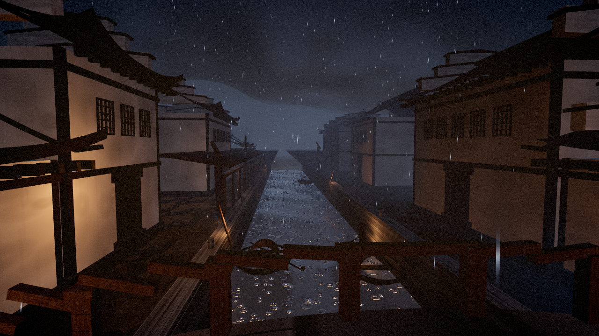
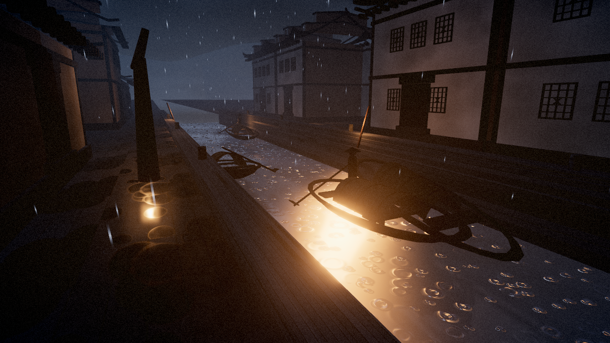
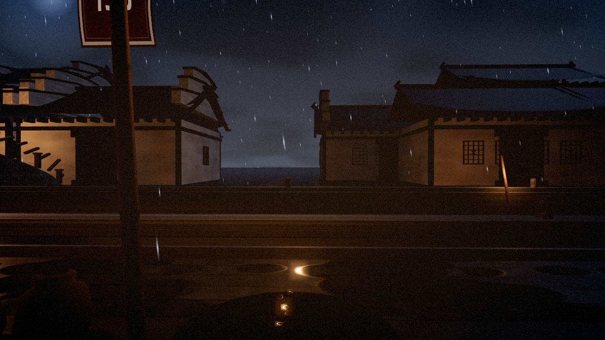
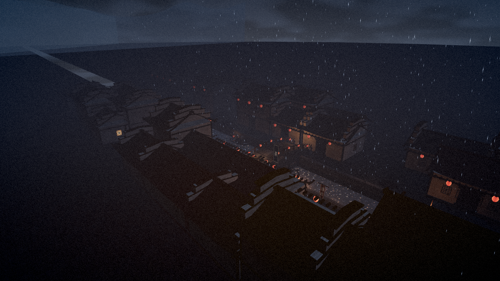

# 夜雨江南 · Jiangnan Rainy Night

An interactive, real-time WebGL demo of a Jiangnan (江南) water town on a rainy
night — white walls and black tiles (粉墙黛瓦), a stone arch bridge over a canal,
乌篷船 boats, glowing silk lanterns, weeping willows and oil-paper umbrellas, all
under falling rain and ink-wash (水墨) mist.

Everything is **procedural**: geometry, textures and even the ambient audio are
generated in code at load time. There are no downloaded assets of any kind.

Built with Three.js + Vite. A live build runs on GitHub Pages:
**https://connect-world-1985-ai.github.io/2026-10-25-jiangnan-rainy-night-demo-glm53flash/**



## Running it

```bash
npm install
npm run dev      # http://localhost:5173
npm run build    # production build in dist/
npm run preview  # serve the production build
```

Any modern browser with WebGL2 works. Deployments happen automatically via
GitHub Actions on every push to `main` (`.github/workflows/deploy.yml`); the
Vite `base` is derived from the repository name so assets resolve under
`/<repo>/`.

## Controls

| Input | Action |
| --- | --- |
| `1` – `4` | Cinematic camera presets: 桥上观澜 (bridge) · 舟行波上 (boat glide) · 深巷灯影 (alley) · 凭虚远眺 (rooftop overview) |
| `5` | First-person walk: `W A S D` move, mouse look (click the canvas to capture the pointer, `Esc` to release), `Shift` to hurry, arrow keys also turn |
| `6` | Orbit mode: drag to rotate, wheel/pinch to zoom |
| `7` | Free-fly: `W A S D` + mouse (or arrows), `Space` up, `C` down, `Shift` fast |
| 雨 / 雾 sliders | Rain intensity and fog density |
| 简 / 雅 / 华 | Quality presets (low / medium / high) |
| `M` or 静音 | Toggle the procedural rain/water ambience |
| `H` | Toggle the help card |
| `F` | Fullscreen |

The walk mode collides with walls, follows the terrain (you can climb the
bridge) and refuses to walk into the canal.



## What's inside (techniques)

- **Curved tile roofs generated in code** — a ruled surface with the classical
  Chinese profile (steep at the ridge, gentle at the eaves, upturned corners
  起翘), merged into a handful of draw calls, with 马头墙 stepped gables, eave
  brackets, ridge fins and 博风板 trim.
- **Planar water reflections** (`Reflector`) driving a custom water shader:
  screen-projected reflection sampling with ripple distortion, animated raindrop
  rings from a hash field, Fresnel mixing, and analytic "light pillar" streaks
  from the nearest lantern lights so the canal glitters even at grazing angles.
- **GPU instancing everywhere it counts**: thousands of rain streaks billboarded
  in the vertex shader, expanding splash rings on the flagstones, lattice
  windows, lanterns and eave brackets.
- **Post chain**: UnrealBloom for lantern halos → an ink-wash grade pass (cool
  shadows, gentle desaturation, vignette, paper grain) → ACES tone mapping and
  sRGB output.
- **Atmosphere**: exponential fog, drifting mist cards, layered ink-wash
  mountain silhouettes, a moon halo, and hearth smoke.
- **Fully procedural textures** (canvas): plaster, roof tiles, stone courses,
  wet flagstones with a matching roughness map for puddles, wood, bamboo matting,
  lantern silk, oil-paper umbrellas, willow leaves and calligraphy banners
  (rendered with system Kaiti/Song fonts at runtime).
- **Synthesised ambience** (Web Audio, no files): filtered noise for rain wash
  and patter, slow swells for wind and canal lapping, all mixed from the rain
  slider.
- **Performance system**: three quality presets (pixel-ratio caps, reflection
  resolution, rain counts, MSAA, shadows, mist density), plus a one-time
  automatic downgrade if the measured frame rate stays low. `renderer.info`
  counters are exposed at `window.__jiangnanStats` for profiling.

## Performance

Measured in a headless Chromium using the SwiftShader software rasterizer
(the VM has no GPU), 1280×720:

| Preset | Draw calls | Triangles |
| --- | --- | --- |
| 简 (low) | ~250–350 | ~210k–310k |
| 雅 (medium) | ~370 | ~320k |
| 华 (high) | ~450 | ~400k |

Draw-call counts include the mirror render pass (the scene is drawn twice) and
post-processing. On real hardware GPUs (integrated graphics included) this
budget sits comfortably at 60 fps at 雅/华; the software rasterizer manages a
choppy but functional fallback, which is exactly what the quality presets and
the auto-downgrade are for. The scene keeps its silhouette readable even when
the frame rate dips: the fog, grain and glow are all cheap passes.



## Limitations

- Reflections are planar and low-resolution by design; the water is stylised
  rather than simulated (no flow dynamics, boat wakes are faked with bobbing).
- The calligraphy on banners and plaques depends on system CJK fonts; without
  one the glyphs fall back to a generic serif.
- Collision is AABB-based, so the walk feels slightly boxy around corners.
- Mobile touch is supported for orbit mode, but the walk mode really wants a
  keyboard. A gamepad/touch joystick would be the natural next step.
- Audio is synthesised noise — convincing rain, but no thunder or voices.



## Credits

- **Three.js** — MIT License — © 2010-2025 three.js authors.
- **Vite** — MIT License — © Evan You & Vite contributors.
- All visual assets (geometry, textures, calligraphy) are **generated
  procedurally at runtime**; the ambient soundscape is synthesised with the Web
  Audio API. No third-party art, audio or fonts are bundled, so the whole demo
  is free of asset licensing.

## Build note

This demo was built end-to-end by a **Cursor cloud agent running GLM 5.3 Flash
with maximum reasoning** — scene generation, shaders, audio synthesis, QA
screenshots and deployment.

## License

MIT — see [LICENSE](LICENSE).
